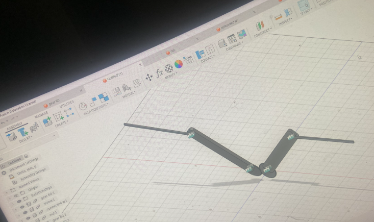

# Ornithopter

A flapping-wing aircraft project to research and learn how aerodynamic forces (lift, thrust, drag, and weight) create flight.

## Goal

My goal is to research and learn more about aerodynamics and how those forces create flight through an ornithopter. In the future, I want to go beyond a single design and test different wing designs, sizes, and materials to see how they change the ornithopter's performance and reactions.

## Start Here

- **See my progress:** [prototype-log.md](prototype-log.md) has dated print results, failures, and next steps.
- **See the design:** the [cad/](cad/) folder has my Fusion 360 files and exports.
- **See the printed parts:** the [images/](images/) folder has photos of my 3D-printed parts.
- **See the research:** [notes/](notes/) has my typed research notes, and [scans/](scans/) has the original handwritten pages.

## Project Status

Research and mechanism design are done. I've printed the first parts of the flapping mechanism (a 60-tooth gear, connecting links, and a pin) and am testing how they fit and move together. See the [prototype log](prototype-log.md) for print results and what I'm changing next.

*Current mechanism in Fusion: two meshed 60-tooth gears, each driving a connected link that carries a wing.*

## How This Repository Is Organized

| Folder / File | What's in it |
|---|---|
| [`prototype-log.md`](prototype-log.md) | Dated progress, print results, failures, and next steps |
| [`cad/`](cad/) | My Fusion 360 design files and exports |
| [`images/`](images/) | Photos of my 3D-printed parts |
| [`notes/`](notes/) | Typed versions of my handwritten research notes, organized by topic |
| [`scans/`](scans/) | Photos of the original handwritten notebook pages (pages 32-43) |

### Why there are two sets of notes

I did my research by hand in a notebook, so the **scans** are the original, unedited record of my thinking. Handwriting and quick sketches aren't easy to read online, so I also retyped everything into the **notes** files. Each note file links to its original pages, and includes a "Corrections / open questions" section where I flag things I've since changed or need to verify.

### Where to find things

- [Gears and mechanism](notes/01-gears-and-mechanism.md): how gears turn motor rotation into motion
- [Reference designs and motor](notes/02-reference-designs-and-motor.md): early ideas and reference measurements
- [Aerodynamics](notes/03-aerodynamics.md): lift, thrust, drag, weight, angle of attack
- [Build planning](notes/04-build-planning.md): scaling, weight budget, component sizes
- [Gear ratio](notes/05-gear-ratio.md): calculations and the gear train design
- [Design decisions](notes/06-design-decisions.md): how and why my plan changed

## Why This Is Taking Longer Than Expected

I spent the first 3-4 months trying to model the entire ornithopter in Fusion 360 at once. That was my biggest mistake: I lost months of progress trying to design everything before I understood the mechanism. I changed my approach to start small and build the **wing mechanism first**, then expand into a full ornithopter once I understand how the flapping works.

Two other things slow the project down:

- **Limited access to 3D printing.** I can only print occasionally, so each design-print-test cycle takes a while.
- **I chose to learn CAD and 3D modeling instead of taking shortcuts.** I could have bought parts or used things from around the house, but I wanted to design and model the parts myself. It takes longer, but I'm gaining experience in CAD, design, and iteration.

## Future Work

After the first working flapping mechanism, I want to test different wing designs, sizes, and materials and compare how they affect the ornithopter's performance.
