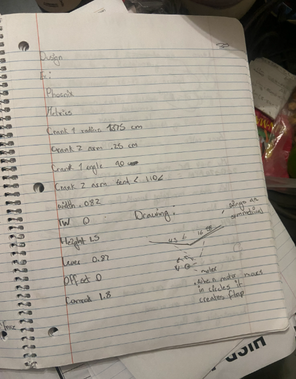
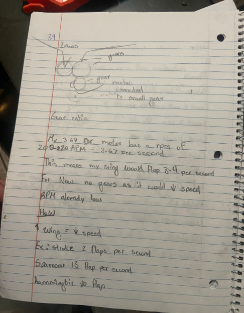
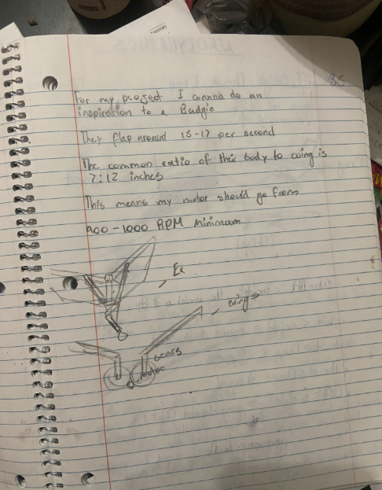

# Reference Designs and Motor

## Page 33: Reference design (Phoenix)

I recorded the measurements of an existing ornithopter design, "Phoenix," to understand how a flapping mechanism is dimensioned.

| Parameter | Value |
|---|---|
| Crank 1 radius | [check: 1.375 or 1.875] cm |
| Crank 2 arm | 0.25 cm |
| Crank 1 angle | 90° |
| Crank 2 arm bend | < 110° |
| Width | 0.082 |
| Height | 1.5 |
| Lever | 0.87 |
| Offset | 0 |
| Conrod (connecting rod) | 1.8 |

My sketch shows symmetrical wings driven by a motor. When the motor turns in circles, it creates the flap.

Source: [add where you found the Phoenix design]

## Page 34: First motor idea

- My 3-6 V DC motor runs at about 200-220 RPM, which is about 3.67 rotations per second.
- If one rotation equals one flap, the wing would flap about 3-4 times per second.
- **Decision at the time:** no gears, because gears would slow it down further and the RPM is already low.
- A larger wing means a slower flap speed (example stroke: 2 flaps per second).
- Reference flap rates I noted: sparrow about 13 flaps/sec, hummingbird about 80 flaps/sec.

## Page 35: Budgie inspiration

- I wanted to base the project on a budgie.
- I noted that budgies flap around 15-17 times per second.
- Body-to-wing ratio noted as 7:12 inches.
- 15-17 flaps/sec is 900-1000 RPM, so my motor would need at least that.
- The sketch shows two meshed gears, each driving a wing, with the motor beside them.

## Corrections / open questions

- **These ideas were later changed.** I dropped the no-gears plan and the budgie target. See [06-design-decisions.md](06-design-decisions.md) and [05-gear-ratio.md](05-gear-ratio.md).
- The flap rates (budgie, sparrow, hummingbird) and the 7:12 ratio need sources. Treat them as approximate until I verify them.
- I need to confirm the crank 1 radius on page 33 and what the other values mean.
