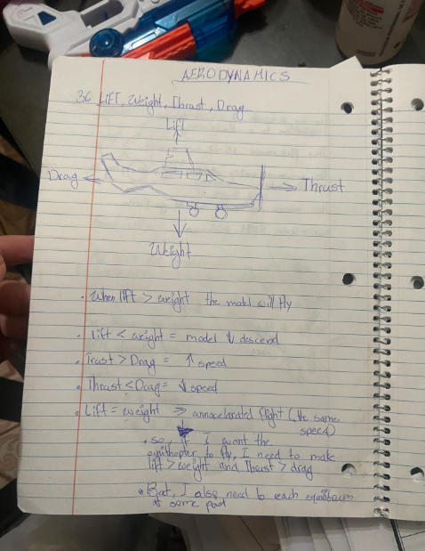
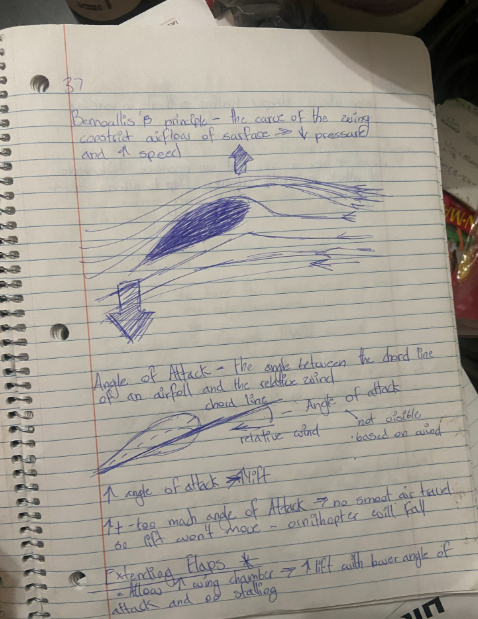
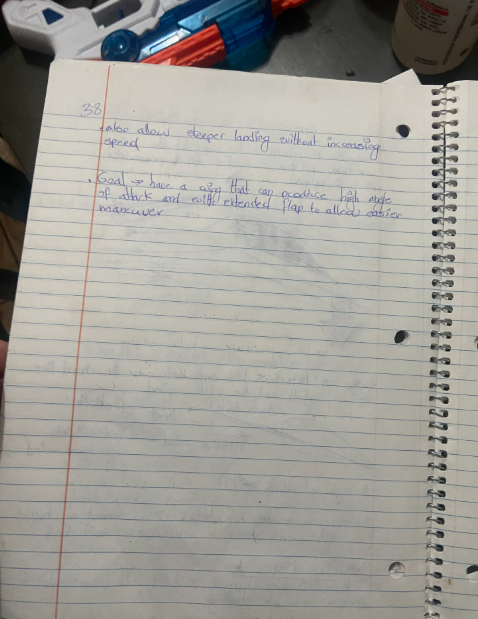
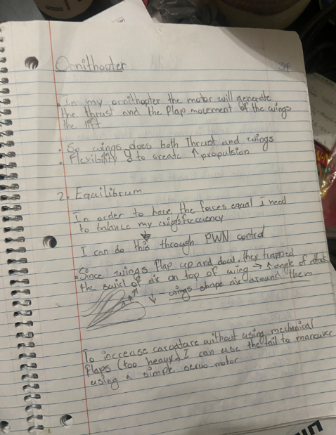

# Aerodynamics

## Page 36: Lift, weight, thrust, drag

The four forces acting on a flying object:
- **Lift** pushes up
- **Weight** pulls down
- **Thrust** pushes forward
- **Drag** pulls backward

What happens when they are not equal:
- Lift > weight: the model rises
- Lift < weight: the model descends
- Thrust > drag: speed increases
- Thrust < drag: speed decreases
- Lift = weight: unaccelerated flight (constant speed)

**What this means for my project:** to get the ornithopter off the ground, I need lift > weight and thrust > drag. But I also need to reach equilibrium at some point so it can keep flying steadily.

## Page 37: How wings make lift

**Bernoulli's principle:** the curve of the wing constricts the airflow over its surface, which lowers the pressure and increases the air speed. The lower pressure on top helps pull the wing up. My sketch also shows air being pushed downward behind the wing.

**Angle of attack:** the angle between the chord line of an airfoil and the relative wind. It is not visible on the wing itself, because it depends on the wind.
- Higher angle of attack leads to more lift.
- Too much angle of attack means the air can no longer travel smoothly over the wing, so lift is lost and the ornithopter will fall (a stall).

**Extending flaps:** extending the wing chamber [check: "chamber" or "camber"] gives more lift at a lower angle of attack and helps avoid stalling.

## Page 38: Flaps and goal

- Extended flaps also allow a steeper landing without increasing speed.
- **Goal:** a wing that can produce a high angle of attack, with an extended flap to allow easier maneuvering.

## Page 39: Applying it to my ornithopter

- The motor generates the thrust, and the flapping motion of the wings generates the lift.
- The wings do both jobs, so wing flexibility is needed to create more propulsion.

**Equilibrium:** to keep the forces equal, I need to balance my wings' flapping frequency. I can do this through gear reduction and PWM control of the motor.

**Air around the wings:** since the wings flap up and down, they trap the swirl of air on top of the wing, which increases the angle of attack. The wings shape the air around them.

**Maneuvering:** to increase curvature without using mechanical flaps (too heavy), I can use the tail to maneuver with a simple servo motor.

## Corrections / open questions

- **Bernoulli is a simplification.** Lift also comes from the wing pushing air downward (Newton's third law), which my page 37 sketch already shows. I want to read more on how the two explanations fit together.
- **Lift > weight** makes the model climb. For steady level flight, lift = weight. My notes say both, and they describe different situations.
- **Flapping flight is different from a fixed wing.** The four-force diagram is drawn for an airplane. In an ornithopter, the angle of attack and airflow change throughout each flap, so the forces are not constant. I need to learn more about this.
- **Thrust:** my page 39 note says the motor generates thrust, but in practice the flapping wings turn the motor's power into both thrust and lift.
- **Tail and servo:** a tail steers (pitch and turning) but does not change wing curvature. I need to clarify what I meant and decide whether the first prototype needs a tail at all
- The design is on hold until the body and wings exist. The first prototype may not need a tail at all.
