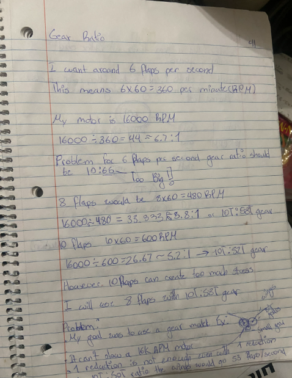
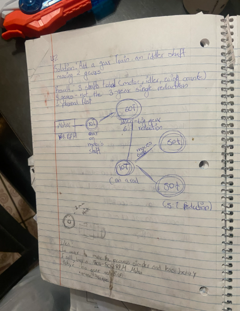

# Gear Ratio

## Page 41: Calculating the ratio

**Target:** about 6 flaps per second, which is 6 x 60 = 360 flaps per minute (RPM at the wing gears).

**Motor speed :** 16,000 RPM .

| Flaps/sec | Wing RPM | Total reduction (16,000 / wing RPM) | Per stage (two stages) | Gear pair |
|---|---|---|---|---|
| 6 | 360 | 44:1 | ~6.7:1 | 10T : 66T (too big) |
| 8 | 480 | 33.3:1 | ~5.8:1 | 10T : 58T |
| 10 | 600 | 26.7:1 | ~5.2:1 | 10T : 52T |

- 10 flaps per second could put too much stress on the parts.
- **At the time I chose 8 flaps per second with 10T : 58T gears.**

**Problem:** my first plan was a single gear reduction. It can't slow a 16k RPM motor enough. Even a 10T : 50T gear (5:1) would give 16,000 / 5 = 3,200 RPM, about 53 flaps per second.

## Page 42: The solution (idler shaft)

**Solution:** add a gear train with an idler shaft that moves two gears or control RPM with PWM

**Result:** 3 shafts total (motor, idler, wing cranks), with more gears than the simple single-reduction setup I planned first.

| Stage | Gears | Reduction |
|---|---|---|
| 1 | 10T on the motor shaft drives a 60T idler gear | 6:1 |
| 2 | 10T on the same shaft as the idler drives two 50T wing gears | 5:1 |
| **Total** | | **30:1** |

- The 10T gear on the idler shaft drives both 50T gears, so the two wings turn in opposite directions.
- Gear thickness sketch: 2 mm.

**Resulting flap rate:** 16,000 / 30 = about 533 RPM, or about 8.9 flaps per second (no load).

**New idea:** to make the process simpler and lighter, I could buy a 300-500 RPM motor.
- No gear reduction needed
- More torque
- 300-500 RPM is about 5-8 flaps per second, which fits my 6 flap target.

## Corrections / open questions

- **Motor RPM mismatch:** these pages say 16,000 RPM, but I later said my motor is 12,000 RPM. I need to read the real number off the motor or its datasheet. At 12,000 RPM, the 30:1 train gives 400 RPM, about 6.7 flaps per second, which is closer to my 6 flap target.
- **Per-stage ratios:** the "6.7:1," "5.8:1," and "5.2:1" values are the square roots of the total ratios (44, 33.3, 26.7), meaning an equal split across two stages. My 10T : 66T "too big" note refers to one stage.
- **Load matters:** the RPM numbers are no-load. Under the weight of the wings and friction in the gears, the real speed will be lower. This is where PWM tuning comes in.
- **Trade-off I haven't tested:** more gear stages mean more weight and more friction losses. The 300-500 RPM motor idea avoids this, but I haven't compared the two options yet.
- **Wing speed vs. torque:** a slower, higher-torque setup moves heavier wings but flaps slower. I
