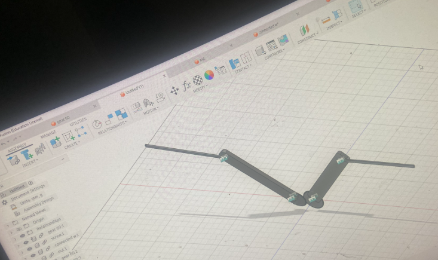
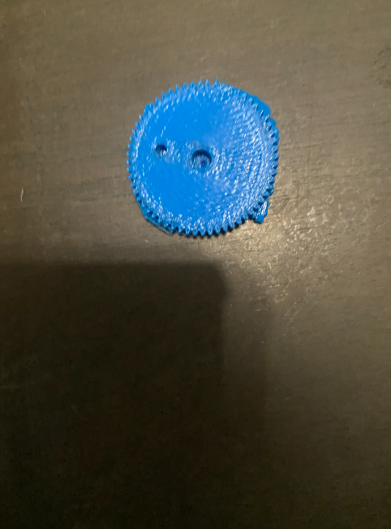
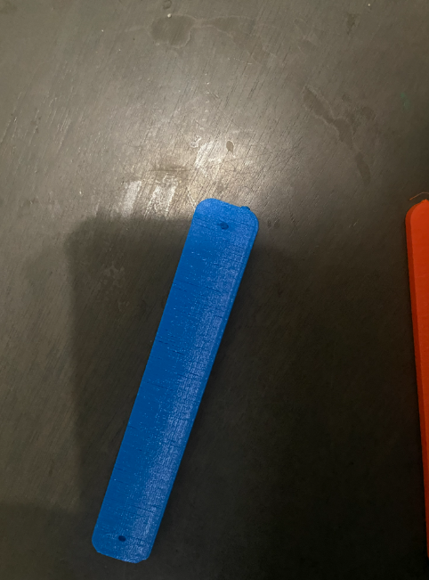
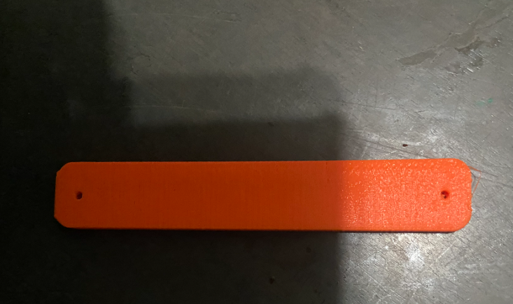
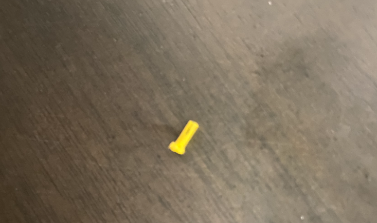
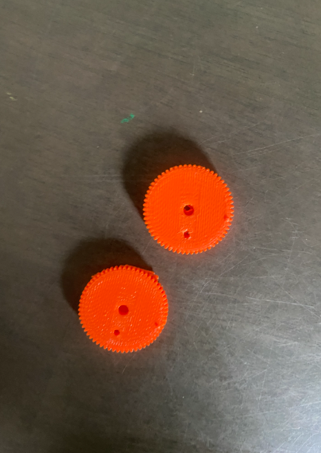

# Prototype Log

A dated record of every design and print for my ornithopter's flapping mechanism: what I made, what worked, what failed, and what I'm changing next.

Back to the [main README](README.md).

## Summary

| Part | Print | Status | Main issue |
|---|---|---|---|
| 60-tooth gear | 1 | Needs reprint | Holes blocked by the base layer, rough teeth |
| Connecting link (blue) | 1 | Needs reprint | Holes blocked, visible layer lines |
| Connecting link (orange) | 1 | Needs reprint | Holes blocked, slight stringing |
| Pin (yellow) | 1 | [Needs testing] | [None noted] |

## Recurring Problems

**1. Printer reliability.** I don't own a printer and can only print occasionally. Some of the printers I've used are temperamental and fail for no obvious reason, so a failed print can cost me days before I can retry.

**2. Holes that don't go all the way through.** This is the biggest problem so far. See [Problem: Blocked Holes](#problem-blocked-holes) below.

---

## Design: Mechanism v1 (Fusion)

**Goal:** Design a gear-driven mechanism that turns rotation from a motor into a symmetrical flapping motion.

**Design:**
* Two 60-tooth gears mesh at the center of the frame.
* Each gear drives a connected link attached at an offset hole.
* Each link carries a wing spar.
* Because the gears turn in opposite directions, both wings flap in sync.
* Screws and nuts hold the assembly together.

**Why I started with the mechanism:** My first attempt was modeling the whole ornithopter at once, which cost me months. Starting with the wing mechanism lets me test the flapping before designing the full body.

**Files:** see the [cad/](/cad/) folder.

---

## Print 1: 60-tooth gear

**Goal:** Test whether a printed gear meshes cleanly and holds the link at its offset hole.

**Result:** The gear printed and the teeth are recognizable, but the print quality is rough.

**Problems:**
* The holes (center hole and offset link hole) did not go all the way through. The base of the print stuck to the part and I couldn't remove it completely.
* The teeth are rough, with extra material on one edge.

**Next step:** Fix the hole problem first (see below), then reprint.

---

## Print 1: Connecting link (blue)

**Goal:** Test the link that converts the gear's rotation into the flapping motion.

**Result:** The shape and length came out correctly.

**Problems:**
* The holes at both ends are not fully open, so a screw can't pass through.
* Visible layer lines along the surface. [Layer height and orientation used.]

**Next step:** Enlarge the holes in CAD and reprint.

---

## Print 1: Connecting link (orange)

**Result:** Cleaner surface than the blue link, with slight stringing near one end.

**Problems:**
* Same blocked-hole problem as the blue link.
* Small amount of stringing. [Retraction or temperature change to try.]

**Next step:** Same hole fix, plus a retraction/temperature adjustment.

---

## Print 1: Pin (yellow)

## Problem: It's not long enough

---
## Gear v2: Better Holes, Base Still Sticking
**What changed:** I printed a new gear with improved hole that go through all the way.

**Result:** The holes came out better, but the base of the gear still stuck to the bottom of the part 

## Print 2: New Gear (orange)

**What happened:** On the gear and both links, the holes are closed or only partly open. The bottom of the print (the layer against the print bed) sticks across the hole, so nothing passes all the way through. I couldn't remove it cleanly, and the screws and pin can't connect the parts. Since the mechanism depends on these holes, none of the printed parts work yet.

**Likely causes** (I still need to confirm which apply):
* **First layer squish ("elephant's foot").** The bottom layers spread outward and shrink the hole, which hurts most on small holes.
* **Raft or brim.** A raft prints a solid layer under the whole part, including under the holes. A brim set to print inside holes can do the same.
* **Holes that are too small.** Printed holes almost always come out smaller than the CAD size, and small holes shrink the most.
* **Printer settings.** A nozzle too close to the bed can over-squish the first layer.

**Fixes to try**

In Fusion (design side):
- [done] Make every hole about 0.3-0.4 mm larger than the screw or pin diameter
- [done] Add a small chamfer (about 0.4 mm) to the bottom edge of each hole to offset first-layer squish

In the slicer (print side):
- [done ] Turn off the raft
- [done] Set the brim to outside only (no brim inside holes)
- [done ] Check the first-layer preview to see whether the holes are open before printing

After printing:
- [ ] Clean out holes with a drill bit by hand, sized to the screw or pin
- [done ] Test-fit a screw before printing more parts

Results:
- the gear came out cleaner. However, the holes still didn't go through completely.
- I will try to just drill the holes or use a better 3d printer from my school.

## Next Steps

1. Update the holes in Fusion and re-export.
2. Print the hole test piece.
3. Reprint the gear and both links as Print 2.
4. Test-fit the mechanism and check how the gears mesh.
5. Add the motor and wings.
